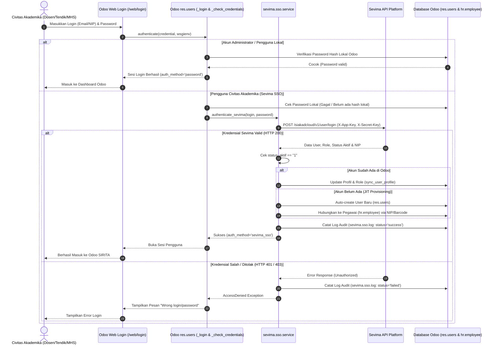

# Rencana Implementasi & Desain Arsitektur Addon SSO Sevima Platform (SIRITA SSO Sevima)

**Institusi:** IAIN Parepare  
**Target Sistem:** Odoo 20 (`my`)  
**Lokasi Addon:** `/home/iain/app-my/addons/sirita_sso_sevima`  
**Sumber API:** [`api_sevima.md`](file:///home/iain/app-my/addons/sirita_sso_sevima/api_sevima.md)  
**Pengembang:** Tim UPT TIPD IAIN Parepare  

---

## 1. Analisis Teknis API Sevima Platform (`api_sevima.md`)

Dokumentasi API Sevima yang dianalisis berasal dari endpoint resmi SIAKAD Cloud Sevima Platform untuk autentikasi pengguna:

### 1.1 Spesifikasi Request
- **Endpoint:** `POST https://api.sevimaplatform.com/siakadcloud/v1/user/login`
- **Metode HTTP:** `POST`
- **Headers Wajib:**
  ```http
  Content-Type: application/json
  Accept: application/json
  X-App-Key: {APP_KEY}
  X-Secret-Key: {SECRET_KEY}
  ```
- **Payload Request (JSON):**
  ```json
  {
      "email": "staging-siacloud-dd@yopmail.com",
      "password": "12345678"
  }
  ```

### 1.2 Karakteristik & Pola Autentikasi
1. **Delegated Passthrough Authentication (Direct Credential Provider):**
   - Berbeda dengan OAuth 2.0 Authorization Code Flow yang membutuhkan multi-redirect browser ke halaman login pihak ketiga, endpoint Sevima ini beroperasi sebagai **Direct Credential Verification Provider**.
   - Server Odoo mengirimkan email dan password pengguna ke API Sevima melalui koneksi aman antar-server (*server-to-server TLS*).
   - **Keunggulan:** Antarmuka login Odoo tetap elegan, cepat, transparan (*frictionless*), dan pengguna kampus (Dosen, Tendik, Mahasiswa) tidak mengalami disorientasi karena tampilan form login `/web/login` tetap seragam di lingkungan kampus IAIN Parepare.
2. **Kredensial Tenant Institusi:**
   - Header `X-App-Key` dan `X-Secret-Key` bertindak sebagai identitas tenant institusi (IAIN Parepare) yang mengizinkan akses ke database SIAKAD Cloud terkait.
3. **Multi-Identifier Support:**
   - Meskipun payload Sevima meminta field `"email"`, sistem SSO yang dirancang mampu melakukan resolusi otomatis dari Nomor Induk Pegawai (**NIP** / **NIDN**) atau **NIM** ke email terdaftar di database lokal, sehingga pengguna dapat login menggunakan email maupun NIP/NIM mereka.

### 1.3 Struktur Respon & Pemetaan Entitas (HTTP 200 OK)
```json
{
    "type": "user",
    "url": "https://api.sevimaplatform.com/siakadcloud/v1/user/login",
    "id": "1",
    "attributes": {
        "user_id": "1",
        "nama": "Contoh Nama",
        "email": "contoh@sevima.com",
        "status_aktif": "1",
        "role": [
            {
                "id_role": "DSN",
                "id_pegawai": "1",
                "nip": "1234567890",
                "nama_role": "Dosen",
                "id_satker": "55201",
                "nama_satker": "Contoh Program Studi"
            }
        ]
    }
}
```

| Field Sevima API | Tipe Data | Pemetaan ke Odoo (`res.users` / `hr.employee`) | Keterangan & Aturan Bisnis |
| :--- | :--- | :--- | :--- |
| `id` / `attributes.user_id` | String | `res.users.sevima_user_id` | Identifier unik akun pengguna Sevima. Dijadikan primary key sinkronisasi. |
| `attributes.nama` | String | `res.users.name`, `res.partner.name` | Nama lengkap resmi beserta gelar akademik terbaru. |
| `attributes.email` | String | `res.users.login`, `res.users.email` | Alamat email resmi untuk identitas login Odoo. |
| `attributes.status_aktif` | String ("1"/"0") | Validasi Akses Odoo | `"1"` = Akun Aktif (diizinkan login). `"0"` = Akun Non-aktif (otomatis ditolak dengan pesan peringatan). |
| `attributes.role[].id_role` | String | `res.users.sevima_role_code` | Kode Peran: `DSN` (Dosen), `TDK`/`PEG` (Tendik), `MHS` (Mahasiswa). Menentukan grup hak akses default. |
| `attributes.role[].nama_role` | String | `res.users.sevima_role_name` | Deskripsi peran resmi Sevima. |
| `attributes.role[].nip` | String | `res.users.sevima_nip`, `hr.employee.barcode` | NIP 18-digit ASN/Dosen atau NIM Mahasiswa. Kunci pencocokan otomatis ke `hr.employee`. |
| `attributes.role[].id_pegawai` | String | `res.users.sevima_id_pegawai` | ID referensi master kepegawaian Sevima. |
| `attributes.role[].id_satker` | String | `res.users.sevima_id_satker` | Kode unit kerja atau program studi penugasan. |
| `attributes.role[].nama_satker`| String | `res.users.sevima_nama_satker` | Nama unit fakultas atau program studi homebase. |

### 1.4 Penanganan Kode Status Error
- **HTTP 401 Unauthorized:** Kredensial tidak valid (email atau password salah, atau akun tidak memiliki hak akses API). Odoo menangkap error ini dan menampilkan notifikasi kesalahan otentikasi standar yang aman tanpa membocorkan detail internal.
- **HTTP 403 Forbidden:** App Key atau Secret Key institusi kadaluarsa, salah, atau IP server Odoo belum didaftarkan di whitelist Sevima.
- **HTTP 500 / Network Timeout:** Server Sevima sedang mengalami gangguan / pemeliharaan berkala. Mekanisme *Fail-Safe Dual Mode* memastikan akun administrator internal Odoo tetap dapat login menggunakan password database lokal.

---

## 2. Arsitektur Sistem Addon SSO Sevima (`sirita_sso_sevima`)

Addon `sirita_sso_sevima` dirancang khusus untuk ekosistem **Odoo 20** dengan prinsip decoupled, modular, dan non-intrusif.

### 2.1 Alur Autentikasi Pengguna (Sequence Diagram)



### 2.2 Komponen-Komponen Utama Addon

```
sirita_sso_sevima/
├── __init__.py                     # Inisialisasi package models dan controllers
├── __manifest__.py                 # Manifest modul Odoo 20 (metadata, depends, data views)
├── api_sevima.md                   # Dokumentasi referensi API Sevima asli
├── README.md                       # Panduan cepat instalasi & konfigurasi
├── controllers/
│   ├── __init__.py
│   └── main.py                     # Extension Home controller (branding login page)
├── data/
│   └── ir_config_parameter_data.xml# Default parameter sistem (URL, toggle, timeout)
├── docs/
│   └── RENCANA_IMPLEMENTASI_SSO_SEVIMA.md # Dokumen arsitektur & rencana teknis
├── models/
│   ├── __init__.py
│   ├── hr_employee.py              # Ekstensi relasi kepegawaian hr.employee
│   ├── res_config_settings.py      # Pengaturan SSO & tombol uji koneksi live
│   ├── res_users.py                # Override _login, _check_credentials, _get_login_domain
│   ├── sevima_sso_log.py           # Model audit trail log autentikasi SSO
│   └── sevima_sso_service.py       # Engine helper komunikasi API Sevima & JIT Provisioning
├── security/
│   ├── ir.access.csv               # Hak akses tabel database
│   └── security.xml                # Definisi grup keamanan Administrator SSO Sevima
└── views/
    ├── login_templates.xml         # Template QWeb form login kustom (/web/login)
    ├── menus.xml                   # Menu navigasi SSO Sevima di bawah Administration
    ├── res_config_settings_views.xml# Form antarmuka konfigurasi di Settings
    ├── res_users_views.xml         # Tab integrasi Sevima SSO pada form User
    └── sevima_sso_log_views.xml    # Antarmuka monitoring audit log SSO (list/form/search)
```

---

## 3. Matriks Pemetaan Peran (Role Mapping) & JIT Provisioning

Ketika pengguna baru pertama kali masuk ke Odoo menggunakan kredensial Sevima, sistem menjalankan **Just-In-Time (JIT) Provisioning**:

| Kode Role Sevima | Nama Role | Kategori Pengguna Odoo | Grup Akses Default Odoo | Integrasi Otomatis |
| :--- | :--- | :--- | :--- | :--- |
| `DSN` | Dosen | Pengguna Internal | `base.group_user` (Internal User) | Dicocokkan ke master `hr.employee` via NIP/Barcode. Ditautkan ke modul akademik/SIRITA. |
| `TDK` / `PEG` | Tenaga Kependidikan / Tendik | Pengguna Internal | `base.group_user` (Internal User) | Dicocokkan ke `hr.employee` via NIP. Terhubung dengan absensi ZKTeco & kepegawaian. |
| `MHS` | Mahasiswa | Pengguna Eksternal (Portal) | `base.group_portal` (Portal User) | Dibuatkan partner portal civitas mahasiswa. |
| `ADM` | Administrator Sevima | Pengguna Internal | `base.group_user` | Disesuaikan dengan wewenang sistem. |

---

## 4. Fitur Keamanan, Fail-Safe, & Audit Trail

1. **Dual-Mode Authentication & Local Admin Fail-Safe:**
   - Administrator Odoo (`admin`, `root`) atau akun lokal darurat tetap dapat masuk ke sistem menggunakan password database PostgreSQL lokal kapan saja, bahkan jika jaringan internet kampus terputus atau server Sevima sedang offline.
2. **Audit Logging & Pemantauan Latency (`sevima.sso.log`):**
   - Setiap upaya autentikasi mencatat:
     - Waktu percobaan (timestamp mikrodetik).
     - Input login (email atau NIP).
     - Alamat IP klien (*client remote address*).
     - Latency respons API Sevima (dalam milidetik).
     - Hasil verifikasi (Sukses, Gagal, atau Error Jaringan).
     - Peran/role yang diterima dari Sevima.
3. **Proteksi Akun Non-Aktif:**
   - Jika pegawai atau mahasiswa dimutasi/dinonaktifkan di Sevima (`status_aktif != '1'`), akses ke Odoo otomatis diblokir saat itu juga, mencegah akses tidak sah pasca-purna tugas.
4. **Pencarian Multi-Kunci (`_get_login_domain`):**
   - Mendukung pencarian akun berdasarkan email maupun NIP dengan memanfaatkan class `Domain` modern Odoo 20:
     ```python
     Domain('login', '=', login) | Domain('sevima_nip', '=', login)
     ```

---

## 5. Rencana Pengujian & Skenario Validasi

| No | Skenario Pengujian | Input Uji | Ekspektasi Hasil | Status |
| :---: | :--- | :--- | :--- | :---: |
| 1 | **Uji Konektivitas Kredensial API** | App Key & Secret Key Sevima | Server Sevima merespon HTTP 200, status koneksi berubah hijau (Terhubung). | Siap Diuji |
| 2 | **Login Dosen Eksisting via Email** | Email Sevima & Password | Login berhasil, data role `DSN` & profil tersinkronkan, diarahkan ke backend Odoo. | Siap Diuji |
| 3 | **Login Dosen via NIP 18-digit** | NIP Pegawai & Password | Sistem otomatis menyelesaikan NIP ke email terdaftar, login berhasil tanpa error. | Siap Diuji |
| 4 | **JIT Provisioning Pengguna Baru** | Akun Sevima baru terdaftar | User Odoo baru otomatis dibuat, group access terpasang, terhubung ke `hr.employee`. | Siap Diuji |
| 5 | **Percobaan Password Salah** | Email valid, password acak | Sevima merespon HTTP 401, Odoo menolak login, log audit mencatat status *failed*. | Siap Diuji |
| 6 | **Blokir Akun Non-Aktif** | Akun dengan `status_aktif: "0"` | Login ditolak dengan pesan "Akun Sevima SIAKAD Anda berstatus non-aktif". | Siap Diuji |
| 7 | **Fail-Safe Administrator Lokal** | User `admin` Odoo lokal | Login admin tetap berhasil tanpa ketergantungan pada server eksternal Sevima. | Siap Diuji |

---

## 6. Panduan Penggunaan & Konfigurasi

1. **Aktivasi Modul:**
   Masuk ke menu **Apps** di Odoo 20, perbarui daftar aplikasi (*Update Apps List*), cari **SIRITA SSO Sevima**, lalu klik **Install**.
2. **Pengisian Kredensial:**
   - Buka menu **Settings -> SSO Sevima** (atau **Administration -> SSO Sevima -> Pengaturan Layanan**).
   - Centang **Aktifkan SSO Sevima Platform**.
   - Masukkan **App Key** dan **Secret Key** resmi Sevima Platform.
   - Atur batas waktu timeout (default 10 detik).
   - Masukkan akun uji coba di bagian *Uji Koneksi & Autentikasi Langsung*, lalu klik **⚡ Uji Login Akun Sevima**.
3. **Monitoring & Log Audit:**
   - Seluruh aktivitas login dapat dipantau di menu **SSO Sevima -> Audit Log Login**.
